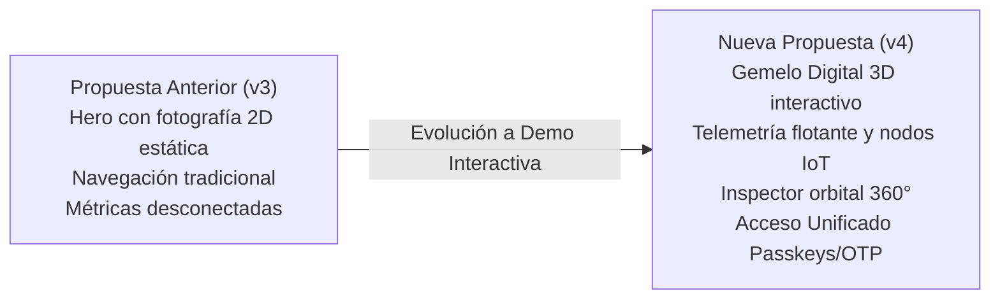
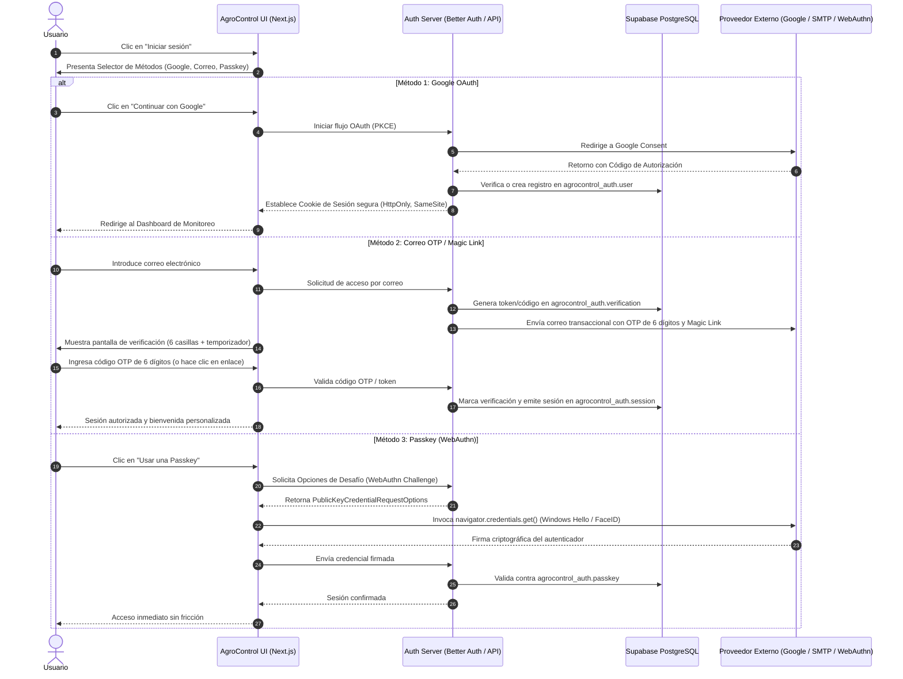
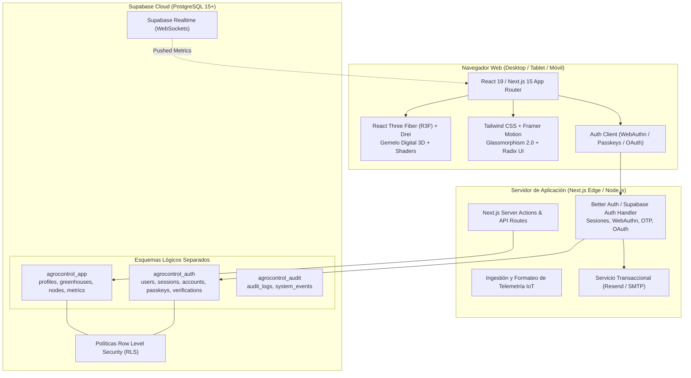

> Documento de propuesta histórica. No acredita funciones implementadas. Consultar AUDITORIA.md para el estado real.

# AgroControl | Propuesta Visual, Diseño de Experiencia y Arquitectura Tecnológica
**Versión 4.0 — Gemelo Digital 3D & Sistema de Autenticación Unificado**  
*Octubre 2026 — Proyecto de Investigación Aplicada (ESPOCH / AgroControl)*

---

## 1. Introducción y Justificación del Cambio de Propuesta

La versión anterior del documento de diseño (Versión 3) planteaba una interfaz web tradicional fundamentada en una fotografía estática en proporción 16:9 de un invernadero físico, acompañada de bloques de contenido y formularios clásicos. Si bien cumplía con estándares de sobriedad, no reflejaba la naturaleza tecnológica avanzada del proyecto ni permitía interactuar de forma inmediata con las variables del entorno agrícola.

A partir del prototipo funcional desarrollado en la demo interactiva (`AgroControl_Inicio_3D_Interactivo.html`), la propuesta visual y funcional evoluciona hacia una **experiencia digital inmersiva basada en un Gemelo Digital 3D en tiempo real**:



### Principales diferencias con la propuesta previa:
1. **Del hero plano al Gemelo Digital 3D:** El usuario ya no ve una fotografía recortada; entra directamente a un modelo tridimensional interactivo del invernadero con simulación de camas de cultivo, plantas, frutos y estructura translúcida de cubierta.
2. **Interacción directa con nodos IoT:** En lugar de métricas estáticas en tarjetas desconectadas, el invernadero 3D proyecta nodos sensores interactivos suspendidos en el espacio con pulsos de radar (`Sensor 01: Temperatura`, `Sensor 02: Humedad`, `Sensor 03: Luz`, `Sensor 04: Suelo`), permitiendo abrir un **Inspector Isométrico 3D flotante** para cada variable.
3. **Controles de inspección agronómica:** La interfaz integra herramientas de exploración en tiempo real: rotación orbital manual (360°), giro automático suave, reinicio de vista y la función de **"Ocultar / Mostrar techo"** para inspeccionar la arquitectura interna de los cultivos.
4. **Estética *Biophilic High-Tech*:** Se sustituye el fondo claro convencional por una atmósfera verde bosque profundo (`#041F1B` / `#072E27`) con mallas sutiles de coordenadas cibernéticas (`grid-noise`), efectos de cristal esmerilado (*glassmorphism 2.0*), acentos bioluminiscentes verde menta (`#56F3BD`) y un toque orgánico dorado cálido (`#EFC369`) para la palabra clave del lema institucional.
5. **Gateway de Autenticación sin contraseñas:** El modal de inicio de sesión se integra armónicamente con la escena 3D y consolida los tres métodos de acceso autorizados: **Google OAuth**, **Correo OTP (6 dígitos) / Enlace Mágico** y **Passkeys (FIDO2 / WebAuthn biométrico)**, respaldados por esquemas seguros en **Supabase PostgreSQL**.

---

## 2. Sistema Visual y Dirección Creativa (Design System)

> [!NOTE]
> La premisa creativa es **"Precisión en los datos. Calidez e inmersión en la experiencia"**. Combina la rigurosidad científica de la investigación agrícola con la fluidez de un software de monitoreo de última generación.

### 2.1 Paleta Cromática Institucional

| Token | Nombre | Código Hex | Muestra | Rol y Aplicación |
| :--- | :--- | :--- | :---: | :--- |
| `--bg` | Bosque Profundo | `#041F1B` |  | Fondo maestro inmersivo del hero y modales. |
| `--forest` | Esmeralda Oscuro | `#08372F` |  | Contenedores primarios, tarjetas 3D y barra de navegación. |
| `--deep` | Verde Abisal | `#062923` |  | Gradientes de oclusión y fondos secundarios. |
| `--mint` | Menta Neón | `#56F3BD` |  | Nodos sensores activos, estados óptimos, glows e indicadores. |
| `--mint-2` | Esmeralda Activo | `#23D196` |  | Botones de acción principal (CTA), enlaces activos y foco. |
| `--leaf` | Hoja Nueva | `#94FFB1` |  | Elementos vegetales 3D y bordes translúcidos. |
| `--gold` | Dorado Cosecha | `#EFC369` |  | Acento editorial en tipografía serif (*"crecer."*). |
| `--glass` | Cristal Esmeralda | `rgba(10,60,49,0.72)` |  | Paneles flotantes de datos con `backdrop-filter: blur(14px)`. |
| `--line` | Borde Especular | `rgba(144,255,206,0.28)` |  | Delimitadores de cristal y líneas estructurales del invernadero. |
| `--panel` | Blanco Niebla | `#F8FBF9` |  | Fondo de secciones públicas institucionales inferiores. |
| `--ink` | Tinta Agrícola | `#16332E` |  | Tipografía de alto contraste sobre fondos claros. |

### 2.2 Tipografía

- **Sans-Serif de Precisión (Interfaz, Métricas y Controles):** `Inter`, con alternativas de respaldo del sistema (`system-ui, -apple-system, Segoe UI`).
  - Títulos principales en escala fluida: `clamp(56px, 7vw, 104px)` con tracking ultra-condensado (`-0.05em`) y `font-weight: 900`.
  - Kickers / Eyebrows: Mayúsculas sostenidas, `font-weight: 800`, tamaño `12px - 14px`, tracking amplio (`0.22em`).
  - Valores numéricos de telemetría: `20px - 24px`, `font-weight: 800`.
- **Serif de Calidez y Acento (Humanización del Proyecto):** `Georgia` o `Playfair Display` en estilo itálico, aplicado a palabras clave de impacto emocional como el cierre de la frase insignia: *"Inteligencia que hace **crecer.***" en tono `--gold` (`#EFC369`).

### 2.3 Normativa de la Marca AgroControl

1. **Uso sobre fondo oscuro / Escena 3D:** Logotipo institucional en versión blanco puro / menta translúcido, sin cajas rectangulares opacas de fondo. Debe respetar un área de protección mínima de 1.5 veces la altura del isotipo vegetal.
2. **Uso sobre fondo claro (Sección inferior institucional / Card de Login derecha):** Versión en verde bosque `#093F33` y esmeralda `#13795B`.
3. **Proporción y escalabilidad:** No condensar ni estirar el vector; mantener vectores SVG puros para máxima nitidez en pantallas de alta densidad (Retina / OLED).

---

## 3. Especificación Detallada de Pantallas y Flujos (Inicio y Login)

### 3.1 Pantalla de Inicio: Hero con Gemelo Digital 3D

```
+---------------------------------------------------------------------------------------------------------+
| [Logo AgroControl]           El proyecto    Tecnología    Impacto    Quiénes somos   [Iniciar sesión ->] |
|                                                                                                         |
| * INNOVACIÓN IOT · AGRICULTURA INTELIGENTE                                                               |
| Inteligencia                                    +-----------------------------------------------------+ |
| que hace                                        | [Gemelo Digital 3D]       Vista 03 / AgroControl    | |
| crecer.                                         |                                                     | |
|                                                 |   [Card Temp: 23.8°C]                               | |
| Monitorea, comprende y transforma cada          |            /\  (Estructura Invernadero)             | |
| variable de tu invernadero desde una            |           /__\                                      | |
| experiencia digital diseñada para el futuro.    |          |  (03)  |                                 | |
|                                                 |    (01)  | |====| |  (02)                           | |
| [ Explorar el proyecto -> ]  (>) Ver 3D         |    ====  | |====| |  ====                           | |
|                                                 |   [Card Hum: 68%]     (04)                          | |
|  ⟲ Escena interactiva · no son lecturas reales  |   (i) Arrastra para girar   [Techo] [Girar] [Reset] | |
|                                                 +-----------------------------------------------------+ |
+---------------------------------------------------------------------------------------------------------+
```

#### Componentes del Hero:
1. **Barra de Navegación Superior (Topbar):**
   - Isotipo + Logotipo AgroControl en SVG blanco sobre fondo transparente.
   - Enlaces ancla: `#proyecto`, `#tecnologia`, `#impacto`, `#quienes`.
   - Botón *"Iniciar sesión →"*: Botón translúcido (`ghost-btn`) con borde especular que activa el modal flotante de autenticación.
   - En pantallas móviles: Menú hamburguesa accesible con panel desplegable.
2. **Columna Izquierda (Mensaje e Intención):**
   - **Kicker:** "Innovación IoT · Agricultura inteligente" con punto indicador verde neón pulsante.
   - **Encabezado principal:** "Inteligencia que hace *crecer.*"
   - **Texto secundario:** Explicación del alcance de monitoreo agronómico.
   - **Acciones:** Botón principal verde esmeralda con elevación sombreada ("Explorar el proyecto →") y botón secundario con ícono de play ("Ver experiencia 3D") que enfoca el viewport directamente en la escena.
3. **Columna Derecha: Contenedor del Gemelo Digital (`.scene-shell`):**
   - **Lienzo 3D en tiempo real:** Estructura geométrica translúcida del invernadero tipo gótico/túnel, surcos de cultivo de tomates con ramas, hojas y frutos esféricos, y suelo con gradiente de iluminación.
   - **Nodos Sensores en Espacio Tridimensional:**
     - `Nodo 01`: Sensor de temperatura aérea (cápsula suspendida con anillo pulsante).
     - `Nodo 02`: Sensor de humedad relativa (ubicación lateral media de cultivo).
     - `Nodo 03`: Sensor de luminosidad PAR (montaje en caballete superior del techo).
     - `Nodo 04`: Sensor de humedad y conductividad de suelo (sonda de inserción radicular).
   - **Tarjetas Flotantes de Telemetría (Glassmorphism):** Superpuestas sobre el lienzo indicando lectura en tiempo real y estado (`23.8 °C · Óptimo`, `68% · Estable`, `Luminosidad · Alta`).
   - **Barra de Controles de Escena:** Botones chip en la base para:
     - `◈ Ocultar techo / Mostrar techo`: Permite conmutar la visibilidad de la cubierta para ver camas internas.
     - `⟳ Girar: sí / no`: Pausa o activa la rotación orbital automática continua.
     - `↺ Reiniciar vista`: Restaura el ángulo de cámara predeterminado (yaw: -0.84, pitch: 0.56, zoom: 13.4).

### 3.2 Inspector Isométrico 3D de Sensores (`info-float`)

Al hacer clic sobre cualquiera de los nodos sensores tridimensionales o sobre las tarjetas de telemetría, se despliega una ventana flotante de inspección con animación suave:
- **Encabezado:** Identificador del componente y botón de cierre (`✕`).
- **Cuerpo dividido en dos zonas:**
  - *Metadata técnica:* Título del nodo, insignia de estado, descripción agronómica, tipo de instalación y rango de operación.
  - *Mini-Visor Isométrico en Vivo:* Renderizado secundario de la sonda/cápsula en 3D wireframe con emisión de luz volumétrica.
- **Acciones Rápidas:** Botón para pasar al siguiente sensor y botón *"Probar acceso"* para abrir directamente el login.

---

### 3.3 Modal de Autenticación Unificada (Login & Gateway)

El acceso al sistema no requiere contraseñas locales vulnerables. Sigue una arquitectura dividida en dos paneles (Split Card) de bordes curvados (`border-radius: 28px`):

```
+---------------------------------------------------------------------------------------+
|                               [ MODAL DE INICIO DE SESIÓN ]                           |
| +-----------------------------------------+-----------------------------------------+ |
| | [Logo AgroControl Blanco]               |                                     [X] | |
| |                                         | BIENVENIDO DE NUEVO                     | |
| | ACCESO INTELIGENTE                      | Inicia sesión                           | |
| |                                         |                                         | |
| | Conectamos                              | Elige el método que prefieras para      | |
| | lo que importa.                         | acceder a tu cuenta de AgroControl.     | |
| |                                         |                                         | |
| | Tu identidad abre el camino a una       | +-------------------------------------+ | |
| | experiencia personalizada dentro del    | | [G] Continuar con Google          > | | |
| | sistema.                                | +-------------------------------------+ | |
| |                                         | +-------------------------------------+ | |
| |                                         | | [✉] Continuar con correo          > | | |
| | [Sistema operativo · 5 sensores activos]| +-------------------------------------+ | |
| |                                         | +-------------------------------------+ | |
| |                                         | | [◈] Usar una Passkey              > | | |
| |                                         | +-------------------------------------+ | |
| |                                         |                                         | |
| |                                         | (v) Tu información siempre protegida.   | |
| +-----------------------------------------+-----------------------------------------+ |
+---------------------------------------------------------------------------------------+
```

#### Panel Izquierdo (Identidad y Contexto Operativo):
- Fondo fotográfico inmersivo del invernadero con gradiente esmeralda superpuesto.
- Logotipo oficial blanco en alta resolución.
- Eslogan: *"Conectamos lo que importa."*
- Píldora de estado del sistema: *"Sistema operativo · 5 sensores conectados"*.

#### Panel Derecho (Selector de Métodos):
- Botón de cierre (`✕`) y texto introductorio.
- **Selector de 3 Métodos de Entrada:**
  1. **Google:** Autenticación instantánea federada mediante OAuth 2.0 / OpenID Connect.
  2. **Correo OTP / Enlace Mágico:** Autenticación por código de 6 dígitos o enlace directo a la bandeja.
  3. **Passkeys:** Autenticación biométrica nativa (Face ID, Touch ID, Windows Hello, huella o llave física FIDO2).

---

### 3.4 Flujo Detallado de Métodos de Autenticación



#### Pantallas Derivadas del Flujo de Acceso:
1. **Entrada de Correo Electrónico:** Campo único con validación de sintaxis en tiempo real, botón prioritario *"Enviar código →"* y botón alternativo *"Enviarme un enlace mágico"*.
2. **Pantalla de Verificación OTP (6 dígitos):** Seis casillas individuales cuadradas con auto-focus continuo, soporte nativo de pegado desde portapapeles (`onPaste`), temporizador regresivo de 60 segundos antes de habilitar reenvío y botón *"Verificar y entrar"*.
3. **Pantalla de Enlace Mágico Enviado:** Mensaje de confirmación indicando el correo destino, estado del envío y opciones de rescate: *"Prefiero usar un código"* o *"Cambiar correo"*.
4. **Completar Perfil (Onboarding paso 2 para nuevos usuarios):** Nombre completo, correo ya verificado (solo lectura) y asignación automática del rol en la plataforma.
5. **Invitación no invasiva a Passkeys (Post-login):** Tras un inicio exitoso con Google o correo, la plataforma ofrece: *"La próxima vez, entra con un gesto. Activa una Passkey en este dispositivo"* con botones *"Activar Passkey"* y *"Ahora no"*.
6. **Estados de Error y Resiliencia:** Mensajes comprensibles y orientados a la solución ante eventos comunes (código vencido, acceso cancelado en Google, error de lectura biométrica) sin revelar si una cuenta existe o no para evitar enumeración de usuarios.

---

## 4. Stack Tecnológico y Arquitectura del Sistema

El sistema demanda un stack que soporte gráficos 3D acelerados por hardware en el cliente, autenticación moderna sin contraseñas, comunicación en tiempo real con sensores IoT y un almacenamiento relacional robusto que coexista sin interferir con bases de datos ya existentes.

### 4.1 Diagrama de Arquitectura Global



### 4.2 Desglose del Stack Tecnológico Recomendado

| Capa | Tecnología | Justificación y Ventajas Técnicas |
| :--- | :--- | :--- |
| **Framework Base** | **Next.js 15 (App Router) + TypeScript** | Renderizado híbrido (SSR para secciones públicas y SEO; componentes de cliente para el canvas 3D y formularios de acceso). Tipado estricto y Server Actions seguras. |
| **Motor 3D** | **Three.js + React Three Fiber (`@react-three/fiber`) + Drei** | Convierte la demo procedural de la prueba de concepto en componentes React modulares y declarativos. Soporta mallas instanciadas (`InstancedMesh`) para renderizar miles de hojas y frutos con mínimo uso de CPU/GPU. |
| **Estilos y Animaciones** | **Tailwind CSS v4 + Framer Motion** | Utilidades CSS aceleradas para efectos de vidrio (`backdrop-blur`), degradados de luz ambiental y transiciones fluidas en modales y paneles flotantes. |
| **Autenticación** | **Better Auth** (conector Supabase) o **Supabase Auth** | Soporte nativo para Passkeys/WebAuthn FIDO2, Google OAuth 2.0, OTP por correo y Magic Links. Almacena sesiones directamente en PostgreSQL bajo esquemas propios sin colisionar con otros proyectos. |
| **Base de Datos** | **Supabase PostgreSQL** | Base de datos relacional potente, extensiones criptográficas (`pgcrypto`), políticas de seguridad a nivel de fila (RLS) y sincronización reactiva por WebSockets. |
| **Tiempo Real** | **Supabase Realtime** | Publicación/Suscripción de eventos para actualizar las lecturas de los sensores en el Gemelo Digital en milisegundos sin recargar la página. |
| **Envío de Correo** | **Resend / Supabase Mailer** | Entrega de correos de verificación OTP y Magic Links con alta entregabilidad y plantillas HTML estéticas corporativas. |

---

### 4.3 Diseño y Esquemas de Base de Datos en Supabase

> [!IMPORTANT]
> Para garantizar que el nuevo sistema de AgroControl conviva pacíficamente con cualquier proyecto o tabla existente en la instancia de Supabase, **todas las tablas se aíslan en esquemas dedicados** (`agrocontrol_auth`, `agrocontrol_app`, `agrocontrol_audit`).

```sql
-- ============================================================================
-- ESQUEMAS DEDICADOS PARA AGROCONTROL
-- ============================================================================
CREATE SCHEMA IF NOT EXISTS agrocontrol_auth;
CREATE SCHEMA IF NOT EXISTS agrocontrol_app;
CREATE SCHEMA IF NOT EXISTS agrocontrol_audit;

-- ----------------------------------------------------------------------------
-- 1. ESQUEMA: agrocontrol_auth (Gestión de Identidad y Credenciales)
-- ----------------------------------------------------------------------------
CREATE TABLE agrocontrol_auth.users (
    id UUID PRIMARY KEY DEFAULT gen_random_uuid(),
    email TEXT UNIQUE NOT NULL,
    email_verified BOOLEAN DEFAULT FALSE,
    name TEXT,
    image TEXT,
    created_at TIMESTAMPTZ DEFAULT NOW(),
    updated_at TIMESTAMPTZ DEFAULT NOW()
);

CREATE TABLE agrocontrol_auth.accounts (
    id UUID PRIMARY KEY DEFAULT gen_random_uuid(),
    user_id UUID NOT NULL REFERENCES agrocontrol_auth.users(id) ON DELETE CASCADE,
    account_id TEXT NOT NULL,
    provider_id TEXT NOT NULL, -- 'google', etc.
    access_token TEXT,
    refresh_token TEXT,
    expires_at TIMESTAMPTZ,
    created_at TIMESTAMPTZ DEFAULT NOW()
);

CREATE TABLE agrocontrol_auth.sessions (
    id UUID PRIMARY KEY DEFAULT gen_random_uuid(),
    user_id UUID NOT NULL REFERENCES agrocontrol_auth.users(id) ON DELETE CASCADE,
    token TEXT UNIQUE NOT NULL,
    expires_at TIMESTAMPTZ NOT NULL,
    ip_address TEXT,
    user_agent TEXT,
    created_at TIMESTAMPTZ DEFAULT NOW()
);

CREATE TABLE agrocontrol_auth.verifications (
    id UUID PRIMARY KEY DEFAULT gen_random_uuid(),
    identifier TEXT NOT NULL, -- email
    value TEXT NOT NULL,      -- código OTP o token hash
    expires_at TIMESTAMPTZ NOT NULL,
    created_at TIMESTAMPTZ DEFAULT NOW()
);

CREATE TABLE agrocontrol_auth.passkeys (
    id UUID PRIMARY KEY DEFAULT gen_random_uuid(),
    user_id UUID NOT NULL REFERENCES agrocontrol_auth.users(id) ON DELETE CASCADE,
    name TEXT DEFAULT 'Mi Dispositivo',
    credential_id TEXT UNIQUE NOT NULL,
    public_key BYTEA NOT NULL,
    counter BIGINT NOT NULL DEFAULT 0,
    transports TEXT[],
    created_at TIMESTAMPTZ DEFAULT NOW(),
    last_used_at TIMESTAMPTZ
);

-- ----------------------------------------------------------------------------
-- 2. ESQUEMA: agrocontrol_app (Perfiles y Dominio Agronómico)
-- ----------------------------------------------------------------------------
CREATE TYPE agrocontrol_app.user_role AS ENUM ('superadmin', 'investigador', 'agronomo', 'operador');

CREATE TABLE agrocontrol_app.profiles (
    user_id UUID PRIMARY KEY REFERENCES agrocontrol_auth.users(id) ON DELETE CASCADE,
    role agrocontrol_app.user_role DEFAULT 'investigador',
    institution TEXT DEFAULT 'ESPOCH',
    phone TEXT,
    created_at TIMESTAMPTZ DEFAULT NOW()
);

CREATE TABLE agrocontrol_app.greenhouses (
    id UUID PRIMARY KEY DEFAULT gen_random_uuid(),
    name TEXT NOT NULL,
    location TEXT,
    model_3d_config JSONB DEFAULT '{}',
    is_active BOOLEAN DEFAULT TRUE,
    created_at TIMESTAMPTZ DEFAULT NOW()
);

CREATE TABLE agrocontrol_app.sensor_nodes (
    id UUID PRIMARY KEY DEFAULT gen_random_uuid(),
    greenhouse_id UUID REFERENCES agrocontrol_app.greenhouses(id) ON DELETE CASCADE,
    code TEXT NOT NULL UNIQUE,     -- Ej: 'sensor-01'
    name TEXT NOT NULL,            -- Ej: 'Temperatura Canopia'
    sensor_type TEXT NOT NULL,     -- 'temperatura', 'humedad', 'luz', 'suelo'
    position_3d JSONB NOT NULL,    -- Coordenadas {x, y, z} para el Gemelo 3D
    status TEXT DEFAULT 'operativo',
    created_at TIMESTAMPTZ DEFAULT NOW()
);

-- ----------------------------------------------------------------------------
-- 3. ESQUEMA: agrocontrol_audit (Trazabilidad y Seguridad sin secretos)
-- ----------------------------------------------------------------------------
CREATE TABLE agrocontrol_audit.auth_logs (
    id BIGSERIAL PRIMARY KEY,
    user_id UUID,
    event_type TEXT NOT NULL,      -- 'login_success', 'otp_requested', 'passkey_used', 'login_failed'
    method TEXT NOT NULL,          -- 'google', 'otp', 'magic_link', 'passkey'
    ip_address TEXT,
    created_at TIMESTAMPTZ DEFAULT NOW()
);

-- Habilitar RLS en esquemas
ALTER TABLE agrocontrol_auth.users ENABLE ROW LEVEL SECURITY;
ALTER TABLE agrocontrol_auth.sessions ENABLE ROW LEVEL SECURITY;
ALTER TABLE agrocontrol_auth.passkeys ENABLE ROW LEVEL SECURITY;
ALTER TABLE agrocontrol_app.profiles ENABLE ROW LEVEL SECURITY;
ALTER TABLE agrocontrol_app.sensor_nodes ENABLE ROW LEVEL SECURITY;
```

---

## 5. Implementación del Gemelo Digital 3D en Producción

En la demo original en HTML puro, la escena se proyectaba mediante un motor trigonométrico manual de perspectiva sobre un `<canvas 2D>`. Para la versión final en la arquitectura de producción (Next.js), este modelo se implementa con **React Three Fiber (R3F)**, aportando las siguientes mejoras críticas:

1. **Eficiencia con `InstancedMesh`:**
   - La estructura de vigas, postes y macizos de plantas se agrupan en una única llamada de dibujo (*Single Draw Call*), reduciendo drásticamente el consumo de batería y memoria en dispositivos móviles.
2. **Materiales Físicos y Translucidez Realista:**
   - Cubierta con `MeshPhysicalMaterial`: efecto de vidrio esmerilado con rugosidad (`roughness: 0.15`), transmisión de luz (`transmission: 0.85`) e índice de refracción (`ior: 1.45`), permitiendo ver el interior sin perder la silueta exterior.
3. **Puntos Calientes / Hotspots HTML Interactivos:**
   - Uso de `<Html>` de `@react-three/drei` con oclusión automática: las etiquetas de los sensores se anclan a las coordenadas `{x, y, z}` del mundo tridimensional y se ocultan suavemente si quedan detrás de las paredes o columnas.
4. **Respaldo Adaptativo (Graceful Degradation):**
   - En navegadores antiguos o terminales con aceleración WebGL desactivada, la interfaz detecta la limitación y conmuta automáticamente al motor ligero Canvas 2D de la demo o a una composición vectorial estática optimizada.

---

## 6. Plan de Entrega e Implementación (Inicio y Login)

| Fase | Tareas Principales | Entregables |
| :---: | :--- | :--- |
| **Hito 1: Setup y Base de Datos** | Creación de esquemas `agrocontrol_auth`, `agrocontrol_app` y `agrocontrol_audit` en Supabase; configuración de RLS; inicialización de proyecto Next.js 15 con TypeScript y Tailwind. | Scripts SQL ejecutados en Supabase, proyecto base configurado con variables de entorno protegidas. |
| **Hito 2: Motor 3D del Gemelo Digital** | Portar la escena 3D de la demo a componentes React Three Fiber; controles de órbita (drag, zoom, reset, toggle techo); hotspot clicables en sensores y tarjetas flotantes. | Componente `<Greenhouse3DScene />` fluido a 60 fps y visor isométrico `<SensorInspector />`. |
| **Hito 3: Autenticación Backend** | Configuración de Better Auth / Supabase Auth; integración de Google OAuth con credenciales de desarrollo; servicio de envío de códigos OTP y Magic Link; soporte de WebAuthn/Passkeys. | Rutas de API `/api/auth/*` funcionales y comprobadas con Postman/cURL. |
| **Hito 4: Interfaz de Acceso (Frontend)** | Maquetación del Modal Split Card con Tailwind; flujo de 6 dígitos OTP con auto-pegado; estados de carga, temporizador regresivo y manejo de errores accesible. | Componentes `<LoginModal />`, `<OtpInput />`, `<PasskeyPrompt />` totalmente interactivos. |
| **Hito 5: Pruebas E2E y Accesibilidad** | Verificación de contraste de color (WCAG 2.2 AA), navegación por teclado (`Tab`, `Esc`, `Enter`), pruebas de biometría en Windows Hello y dispositivos móviles. | Certificación de accesibilidad y flujo de autenticación completo sin contraseñas. |

---

*Documento técnico y visual generado como base oficial para el desarrollo de la interfaz de AgroControl.*
